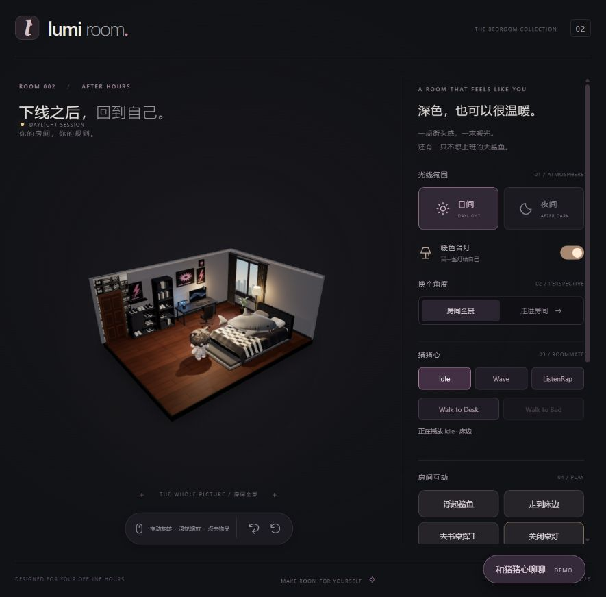

# Lumi Room · A Living AI Space

**A cozy 3D bedroom with a plush roommate, expressive conversations and real furniture interactions.**

一个可以让自己放松下来的 3D 房间：陪猪猪心挥手、听 Rap、在床边和书桌间走走，也可以 Fork 一份属于自己的角色性格。

**[Live Demo](https://spontaneous-licorice-fbdd12.netlify.app/)** · Existing static game. Netlify Qwen Functions are implemented on the Week 07 branch; production AI remains disabled pending owner setup and authorization.



## What works / 已实现

| Feature | Current evidence |
|---|---|
| Blender bedroom, shark, furniture, lighting | GLB models loaded in React Three Fiber; mouse orbit/zoom and room views verified |
| 猪猪心 / plush roommate | One character instance; approved 12-bone rig; Idle, Wave, ListenRap, Walk |
| Expressions / 表情 | Nine approved material states; shared manual/AI controller; chat-expression integration tested offline |
| Walking / 行走 | Validated Bed ↔ Desk corridor, smooth turning, ground compensation and true arrival feedback |
| Furniture / 家具互动 | Shark floats/returns; bed returns the roommate to Bed; desk walks then waves; independent desk-lamp toggle and fade |
| Qwen / 对话 | Server-side single-request reply + commands + optional expression; local precise commands avoid paid calls |
| Action Bridge | One existing FIFO bridge; real arrival and animation completion; cancellation and duplicate protection |
| Custom character / 自定义人设 | Private owner-controlled Markdown, official fallback, strict file validation and opt-in |

The Week 04 complex Qwen command passed one real validation with the final Desk + ListenRap state; that is not broad semantic coverage or a full uninterrupted motion recording. The newer expression field has Mock coverage only. No new paid calls were made for this release.

Sit, Read, HugShark, cabinet-door animation, audio playback, arbitrary navigation and Rain are **not implemented**. ListenRap is a silent original rhythm animation. Mobile narrow-screen clicks were checked; real phones/WeChat browsers still need validation. Production public AI remains disabled until spend, access and compliance controls are ready; Demo and local actions remain usable.

## Stack & architecture / 技术架构

Vite · React · TypeScript · Three.js · React Three Fiber · drei · Blender/bpy · Node.js · AJV · Alibaba Cloud Qwen.

```text
ChatPanel / chatStore
  ├─ precise local intent → strict ActionPlan → existing ActionBridge
  └─ same-origin /api/action-intent → CharacterPromptBuilder → Qwen
       └─ validated reply + commands + expression
            ├─ ActionBridge → existing character Mixer / Walk / real arrival
            └─ expressionStore → existing character instance material maps
Furniture clicks → roomInteractions → same ActionBridge (no competing character controller)
```

The room loads named Blender groups from cozy-room.glb. Shark and character use their own existing GLBs. No new rig, second character or second Mixer is created for AI/furniture interactions. Character rules remain server-side; core assets are served locally, not fetched at runtime from GitHub/CDNs.

## Run locally / 本地运行

Use Node.js 24 LTS and npm. Fork/clone the repository, then:

```bash
git clone https://github.com/Aurelia1027/zhuzhuxin.git
cd zhuzhuxin
npm ci
cp .env.example .env
npm run dev
```

PowerShell: replace `cp` with `Copy-Item .env.example .env`. Open the **Local** URL printed by Vite, normally http://127.0.0.1:5173/. The Vite development/preview plugin includes the existing Node API; you do not need a second API process for local Vite use.

```bash
npm run typecheck
npm test
npm run build
npm run preview
npm run release:audit
```

Production output is dist/. `npm run serve:dialogue` starts the standalone same-origin API for a future reverse proxy; `npm run preview` is a local preview, not an internet deployment service. This repository is not yet deployed.

## Configure your own Qwen / 安全配置

Edit your **local ignored .env**, never a VITE_-prefixed variable:

```dotenv
DASHSCOPE_API_KEY=your-own-provider-key
QWEN_ENABLE_PAID_REQUESTS=true
QWEN_MODEL=qwen-plus
CHARACTER_CUSTOM_ENABLED=false
```

Restart the local server after changing environment variables. Requests may incur your own provider charges; no author-owned credentials or unlimited free AI access are supplied. Default .env.example disables paid requests. Never send keys to the project author, commit them, or put them in browser code, screenshots or issues. Use provider-side limits. The proposed personal RMB50 budget has **not** been implemented as a persistent monetary cap in this GitHub-only release.

The original Node HTTP service keeps its production paid-route gate. The Netlify Functions adapter uses the separate, explicit server-side `PUBLIC_QWEN_ENABLED` switch (default false), `DASHSCOPE_API_KEY`, bounded input/output and best-effort per-instance rate limits. Production use depends on owner-confirmed provider-side hard stop; no Redis or application monetary budget is implemented. See [Netlify setup and test results](docs/week07-netlify-qwen.md) and [SECURITY.md](SECURITY.md).

## How to Customize Your Character

1. Fork Lumi Room and run **your own** checkout/server.
2. Copy the template:

   ```bash
   cp docs/character/character.custom.example.md docs/character/character.custom.md
   ```

3. Edit its personality, tone, interests, habits, background and relationship sections in UTF-8 Markdown. Keep the first heading and at least one second-level heading; maximum 8000 characters / 16384 bytes.
4. Set `CHARACTER_CUSTOM_ENABLED=true` in your ignored .env, configure your own lawful Qwen credentials, restart and select Qwen AI locally.

The original docs/character/zhuzhuxin.md v0.2 is preserved verbatim. Custom preferences override only the style/personality fields of your instance; output safety and real action/expression whitelists remain authoritative. Missing or invalid files safely fall back to the official rules. No arbitrary path, URL upload or executable template is supported.

Your private custom Markdown is sent to your chosen model provider as prompt configuration **only after you explicitly enable it**. It is not automatically sent to this project's author, scanned from your Fork, or applied to the official site. See [customization details](docs/character-customization.md).

## Optional character ideas / 自愿投稿

You may use the entire game without submitting anything. To share an idea, open a PR using the [character-idea template](.github/PULL_REQUEST_TEMPLATE/character-idea.md), with only the text you deliberately want public. Maintainers and GitHub users can read public PRs; accepted ideas may improve later versions. Never attach private custom files, chats or keys. [Privacy and deletion limits](PRIVACY.md) · [Contributing](CONTRIBUTING.md).

## Project map / 目录

```text
src/scene/                 Blender room, picking, lights and camera
src/characters/            approved animation, Walk and shared expression binding
src/interactions/          lightweight furniture adapter
src/stores/                chat and expression state
server/character/          official/custom private rules loaders
server/prompts/            compatible CharacterPromptBuilder
server/llm/                Qwen transport, output schema and safe diagnostics
server/tests/              offline regression tests
public/models/             runtime GLBs and expression JPEGs
docs/character/            official v0.2 and custom template (private copy ignored)
deployment/                future deployment examples; not deployed
scripts/                   safe release audit and allowlisted candidate builder
```

## License, privacy & limits / 许可与限制

Source code and developer documentation: [MIT](LICENSE). Models, likenesses, character text and third-party material are **not automatically MIT**: see [ASSET_LICENSE.md](ASSET_LICENSE.md). The owner confirmed public distribution rights; retain actual permission records. No music or downloaded font files are bundled; fonts use the system stack.

No hidden telemetry, automatic Fork synchronization or public private-character database is included. [PRIVACY.md](PRIVACY.md). The minimal release omits Blender working backups, historical character models, private configurations and test logs. Runtime character GLB is about 50.7 MB; first load on mobile can be slow. Build emits existing engine chunk-size warnings; low-end device performance is not certified.

## Next / 后续计划

- Render/other hosting deployment and real HTTPS/mainland-network acceptance (Coming Soon).
- Controlled friends-only AI access and a persistent RMB50 spending policy, with explicit real-test authorization.
- Real Qwen expression-semantic checks and mobile/WeChat validation.
- Sit/Read/HugShark only after real assets/actions are separately designed and accepted.

See [release checklist](docs/release-v1-checklist.md), [GitHub/deployment notes](docs/github-and-deployment.md) and [verified furniture scope](docs/week05-furniture-interactions.md).
